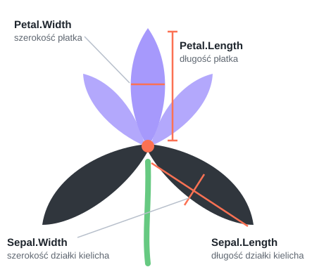
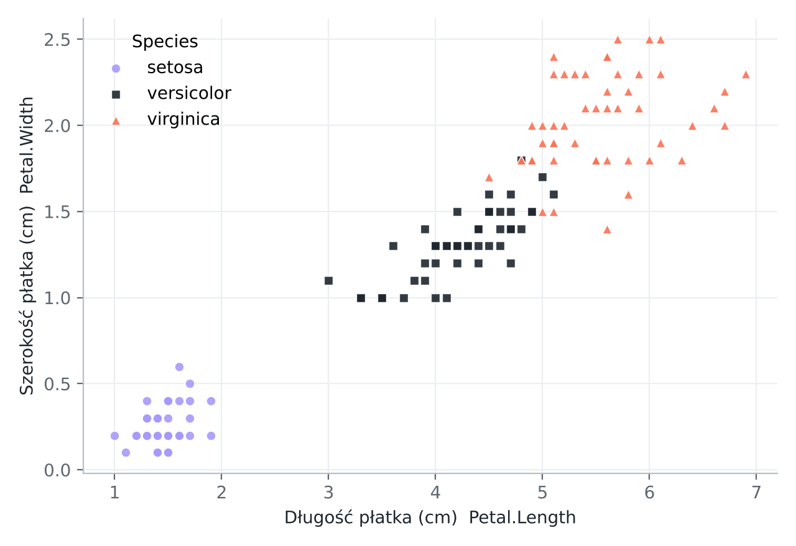

## {.cdv-title background-image="assets/cdv_tytul.png" background-size="cover" background-position="center"}


::: {.cdv-title-text}
[Podstawy programowania w R]{.cdv-kicker}

# Wprowadzenie do R i typy danych

[Łukasz Wawrowski]{.cdv-author}

[Studia podyplomowe Big Data & Society]{.cdv-meta}
:::

## Plan zjazdu {.smaller .w-plan}

::: {.columns}
::: {.column width="52%"}
**Cel kursu:** mój pierwszy raport z własnych danych.

**Cel zjazdu:** swobodnie uruchamiać kod w R, rozumieć, co zwraca, wiedzieć, jak R przechowuje dane, i wczytać dane z pliku.

Pracujemy w **RStudio w przeglądarce** na [posit.cloud](https://posit.cloud). Nic nie trzeba instalować.

Po zjeździe: R na własnym komputerze i **Twój** zbiór danych.
:::
::: {.column width="48%"}
| Czas | Blok |
|---|---|
| 20 min | start: cel kursu, środowiska pracy, Posit Cloud |
| 60 min | blok A: R jako kalkulator, skrypt, funkcje |
| 15 min | przerwa |
| 70 min | blok B: obiekty, wektory, braki danych |
| 10 min | przerwa |
| 50 min | blok C: ramka danych i zbiór iris |
| 35 min | blok D: wczytywanie danych z pliku |
| 10 min | podsumowanie |
:::
:::

::: notes
Interfejs RStudio omawiam na żywo, slajdów o panelach nie ma.
:::

## Język R {.smaller}

::: {.columns}
::: {.column width="55%"}
Interpretowany język programowania i środowisko do obliczeń statystycznych oraz wizualizacji wyników.

- darmowy i wieloplatformowy
- duża społeczność, używany w nauce, biznesie i administracji
- jedno oficjalne źródło pakietów (CRAN), które ze sobą współpracują
- 25 822 pakietów (27.11.2025)
:::
::: {.column width="45%"}
> „R is not a language driven by the purity of its philosophy; R is a language designed to get shit done.”
>
> Hadley Wickham

**Co zrobimy w R:** obliczenia, zestawienia, wykresy, raporty ([Quarto](https://quarto.org/docs/gallery/)), dashboardy ([Shiny](https://shiny.posit.co/r/gallery/)), mapy ([Geocomputation with R](https://r.geocompx.org/)).
:::
:::

## Środowiska pracy z R {.smaller}

| Narzędzie | Co to jest | Kiedy |
|---|---|---|
| **R** ([r-project.org](https://www.r-project.org/)) | sam język i konsola; trzeba go zainstalować zawsze, gdy pracujemy na swoim komputerze | podstawa wszystkiego |
| **RStudio Desktop** ([posit.co](https://posit.co/download/rstudio-desktop/)) | najpopularniejsze środowisko (IDE) do R: edytor, konsola, podgląd danych i wykresów | praca na własnym komputerze |
| **Positron** ([positron.posit.co](https://positron.posit.co/)) | nowsze IDE od Posit dla R i Pythona | gdy pracujesz też w Pythonie |
| **Posit Cloud** ([posit.cloud](https://posit.cloud/)) | RStudio w przeglądarce, bez instalacji | **na naszych zajęciach** |

RStudio Desktop i RStudio w Posit Cloud wyglądają i działają tak samo, więc to, czego nauczysz się na zajęciach, przeniesiesz 1:1 na swój komputer.

::: notes
Tu omawiam interfejs RStudio na żywo w Posit Cloud.
:::

## Gdzie szukać pomocy {.smaller}

| Źródło | Do czego |
|---|---|
| klawisz **F1** na nazwie funkcji | dokumentacja: argumenty i przykłady |
| [R for Data Science](https://r4ds.hadley.nz/) | kompendium R (po angielsku, za darmo) |
| [Big Book of R](https://www.bigbookofr.com/) | katalog książek o R na każdy temat |
| [Ściągawki Posit](https://posit.co/resources/cheatsheets/) | jedna strona A4 na pakiet |
| [rweekly.org](https://rweekly.org/) | co tydzień nowości ze świata R |

## Start w Posit Cloud {.smaller}

::: {.columns}
::: {.column width="55%"}
1. Wejdź na [posit.cloud](https://posit.cloud) i zaloguj się.
2. **New Project → New RStudio Project**.
3. Nadaj projektowi nazwę, np. `zjazd1`.
4. **File → New File → R Script** i zapisz skrypt (`Ctrl + S`).
5. Pliki z danymi wgrywasz przyciskiem **Upload** w panelu *Files*.
:::
::: {.column width="45%"}
::: {.callout-tip}
## Dobre nawyki
- jeden temat = jeden projekt
- pakiety instalujemy osobno w każdym projekcie: `install.packages("nazwa")`
- darmowe konto ma miesięczny limit godzin pracy, więc po zajęciach zamykamy projekt
:::
:::
:::

::: notes
Pokaż na żywo panele: Source, Console, Environment, Files/Plots/Help.
:::

## Kilka podstawowych zasad

- R rozróżnia wielkość liter: `dane` i `DANE` to dwa różne obiekty
- separatorem dziesiętnym jest **kropka**: `3.14`, nie `3,14`
- w ścieżkach do plików używamy `/`, np. `"data/bank.csv"`
- kod piszemy w **skrypcie**, a nie w konsoli: skrypt można zapisać i uruchomić ponownie

## Rozgrzewka: jaki jest wynik

```r
6 / 2 * (1 + 2)
```

::: {.columns}
::: {.column width="50%"}
- A. `1`
- B. `9`
- C. `6`
- D. błąd
:::
::: {.column width="50%"}
<button class="w-btn" data-reveal-target="ans-warmup">Pokaż odpowiedź</button>

::: {#ans-warmup .w-hidden .w-feedback .ok}
**B. `9`**. R liczy jak w szkole: najpierw nawias (`3`), potem mnożenie i dzielenie **od lewej do prawej**: `6 / 2 = 3`, `3 * 3 = 9`.
:::
:::
:::

## Skrypt: komentarze, sekcje, uruchamianie {.smaller}

::: {.columns}
::: {.column width="50%"}
**Komentarz** zaczyna się od `#`. R go nie wykonuje.

```r
# liczę średnią sprzedaż
mean(sprzedaz)
```

`Ctrl + Shift + C` wstawia i usuwa komentarz.

**Sekcja** porządkuje skrypt (spis w lewym dolnym rogu edytora):

```r
# Wczytanie danych ---------------------------
```

`Ctrl + Shift + R` wstawia sekcję.
:::
::: {.column width="50%"}
**Uruchamianie kodu:** przycisk *Run* albo `Ctrl + Enter`.

- kursor w linii → uruchamia tę linię
- zaznaczony fragment → uruchamia zaznaczenie
- `Ctrl + Shift + Enter` → cały skrypt

W konsoli:

- `>` R czeka na polecenie
- `+` R czeka na **dokończenie** polecenia (brakuje nawiasu lub cudzysłowu). `Esc` przerywa.
:::
:::

## Funkcje i argumenty

```r
nazwa_funkcji(argument1 = wartosc1, argument2 = wartosc2)
```

::: {.columns}
::: {.column width="50%"}
**Po nazwach** kolejność nie ma znaczenia:

```r
log(x = 8, base = 2)
log(base = 2, x = 8)
```
:::
::: {.column width="50%"}
**Pozycyjnie** kolejność ma znaczenie:

```r
log(8, 2)
```

Kolejność argumentów sprawdzisz w pomocy (`F1`).
:::
:::

Funkcja z konkretnego pakietu: `nazwa_pakietu::nazwa_funkcji()`, np. `dplyr::filter()`.

## Argumenty na żywo {.w-interactive}

<span class="w-tag">Przykład interaktywny</span> Zmieniaj liczby, sposób podawania argumentów i ich kolejność.

<div class="w-logbuilder" id="logbuilder"></div>

## R jako kalkulator {.smaller}

::: {.columns}
::: {.column width="45%"}
| Zapis | Działanie |
|---|---|
| `+  -  *  /` | podstawowe działania |
| `^` | potęga |
| `sqrt(x)` | pierwiastek |
| `exp(x)` | e do potęgi x |
| `log(x, base)` | logarytm |
| `abs(x)` | wartość bezwzględna |
| `factorial(x)` | silnia |
| `round(x, digits)` | zaokrąglenie |
:::
::: {.column width="55%"}
<div class="w-timer" data-widget="timer" data-minutes="4"></div>

**Ćwiczenie**

1. Oblicz 5 · log₃(27). Zapisz argumenty raz pozycyjnie, raz po nazwach.
2. Oblicz log₁₀(100) + √121 na dwa różne sposoby.
3. Wpisz wynik zadania 2 w Poll Everywhere.

<button class="w-btn w-ghost w-small" data-reveal-target="ans-calc">Pokaż rozwiązanie</button>

::: {#ans-calc .w-hidden}
```r
5 * log(27, 3)                 # 15
5 * log(x = 27, base = 3)      # 15
log10(100) + sqrt(121)         # 13
log(100, base = 10) + 121^0.5  # 13
```
:::
:::
:::

## Wartości nieliczbowe {.smaller}

| Wartość | Znaczenie | Przykład |
|---|---|---|
| `NA` | brak danych (*not available*) | nie znamy wzrostu respondenta |
| `NaN` | wynik nieokreślony (*not a number*) | `0 / 0` |
| `Inf`, `-Inf` | nieskończoność | `1 / 0` |
| `NULL` | pusty obiekt | wynik bez zawartości |

Braki danych „psują” obliczenia. Wiele funkcji ma argument `na.rm = TRUE` (*NA remove*), który je pomija.

## Sprawdź się: co zwróci R? {.w-interactive}

<span class="w-tag">Sprawdź się</span> Wylosuj wyrażenie i wybierz wynik.

```{=html}
<div class="w-quiz" data-widget="quiz"><script type="application/json">
{"button": "Losuj wyrażenie",
 "items": [
  {"code": "1 / 0", "options": ["0", "Inf", "NaN", "błąd"], "answer": "Inf", "why": "Dzielenie dodatniej liczby przez zero daje nieskończoność."},
  {"code": "0 / 0", "options": ["0", "Inf", "NaN", "NA"], "answer": "NaN", "why": "Wynik jest nieokreślony: Not a Number."},
  {"code": "-5 / 0", "options": ["-Inf", "Inf", "NaN", "błąd"], "answer": "-Inf", "why": "Ujemna liczba przez zero to minus nieskończoność."},
  {"code": "mean(c(2, 4, NA))", "options": ["3", "2", "NA", "błąd"], "answer": "NA", "why": "Jeden brak danych sprawia, że średnia jest nieznana."},
  {"code": "mean(c(2, 4, NA), na.rm = TRUE)", "options": ["3", "2", "NA", "6"], "answer": "3", "why": "na.rm = TRUE pomija NA, więc liczymy średnią z 2 i 4."},
  {"code": "sqrt(-4)", "options": ["-2", "2", "NaN", "błąd"], "answer": "NaN", "why": "Pierwiastek z liczby ujemnej nie jest liczbą rzeczywistą. R zwraca NaN i ostrzeżenie."},
  {"code": "NA > 5", "options": ["TRUE", "FALSE", "NA", "błąd"], "answer": "NA", "why": "Nie wiemy, ile wynosi brak danych, więc nie wiemy, czy jest większy od 5."},
  {"code": "sum(c(TRUE, TRUE, FALSE))", "options": ["2", "TRUE", "3", "błąd"], "answer": "2", "why": "TRUE liczy się jako 1, a FALSE jako 0. Tak łatwo policzyć, ile razy warunek był spełniony."},
  {"code": "as.numeric(\"12,5\")", "options": ["12.5", "125", "NA", "12"], "answer": "NA", "why": "Przecinek nie jest separatorem dziesiętnym w R. Zamiana tekstu na liczbę się nie udaje i dostajemy NA z ostrzeżeniem."}
 ]}
</script></div>
```

## Obiekty i przypisanie {.smaller}

Wynik zapisujemy w **obiekcie** za pomocą `<-` (skrót `Alt + -`):

```r
wzrost <- 173
wzrost_m <- wzrost / 100
```

Obiekt pojawia się w panelu **Environment**. Znak `=` też zadziała, ale `<-` jednoznacznie oznacza tworzenie obiektu.

**Nazwy obiektów:** małe litery i podkreślnik (`dane_2025`) albo camelCase (`daneKlientow`). Bez spacji, polskich znaków i cyfry na początku.

## Sprawdź się: dobra nazwa? {.w-interactive}

<span class="w-tag">Sprawdź się</span> Oceń, czy taka nazwa obiektu zadziała.

```{=html}
<div class="w-quiz" data-widget="quiz"><script type="application/json">
{"button": "Losuj nazwę", "code": false,
 "options": ["Poprawna i zalecana", "Działa, ale lepiej unikać", "Błąd"],
 "items": [
  {"code": "dane_2025 <- 1", "answer": "Poprawna i zalecana", "why": "Małe litery, podkreślnik, cyfry na końcu."},
  {"code": "2025_dane <- 1", "answer": "Błąd", "why": "Nazwa nie może zaczynać się od cyfry."},
  {"code": "dane klientow <- 1", "answer": "Błąd", "why": "Spacja kończy nazwę, R nie rozumie reszty."},
  {"code": "dane-2025 <- 1", "answer": "Błąd", "why": "Minus to odejmowanie: R próbuje policzyć dane minus 2025."},
  {"code": "daneKlientow <- 1", "answer": "Poprawna i zalecana", "why": "Zapis camelCase jest w porządku. Ważne, żeby w całym skrypcie stosować jeden styl."},
  {"code": "średnia <- 1", "answer": "Działa, ale lepiej unikać", "why": "Polskie znaki działają, ale mogą sprawiać kłopot przy zmianie kodowania lub komputera."},
  {"code": "mean <- 1", "answer": "Działa, ale lepiej unikać", "why": "Nazwa zasłania funkcję mean() i myli czytelnika."},
  {"code": "T <- 0", "answer": "Działa, ale lepiej unikać", "why": "T to skrót od TRUE. Po takim przypisaniu T znaczy 0, co prowadzi do trudnych błędów."},
  {"code": "wynik.koncowy <- 1", "answer": "Poprawna i zalecana", "why": "Kropka w nazwie jest dozwolona, choć dziś częściej używa się podkreślnika."}
 ]}
</script></div>
```

## Typy obiektów {.smaller}

| Obiekt | Co przechowuje | Przykład |
|---|---|---|
| **wektor** | wartości jednego typu | wzrost 100 osób |
| **czynnik** (*factor*) | kategorie | wykształcenie |
| **ramka danych** (*data frame*) | tabela: kolumny różnych typów | ankieta, arkusz z Excela |
| macierz | tabela liczb jednego typu | macierz korelacji |
| lista | dowolne obiekty razem | wynik modelu |

W tym kursie najczęściej pracujemy na **ramkach danych**, a każda ich kolumna to **wektor**.

## Wektor {.smaller}

Wektor tworzymy funkcją `c()` (*combine*). Wszystkie elementy mają **ten sam typ**:

```r
pali   <- c(TRUE, FALSE, TRUE)          # logiczny (logical)
wzrost <- c(173, 170, 163)              # liczbowy (double)
plec   <- c("m", "k", "k")              # tekstowy (character)
```

Przydatne funkcje:

| Funkcja | Wynik |
|---|---|
| `length(x)`, `typeof(x)` | długość i typ |
| `rep("a", 3)`, `seq(0, 10, by = 2)`, `1:5` | tworzenie wektorów |
| `is.numeric(x)`, `as.numeric(x)` | sprawdzanie i zamiana typu |
| `letters`, `month.name`, `pi` | stałe wbudowane |

## Sprawdź się: jaki typ? {.w-interactive}

<span class="w-tag">Sprawdź się</span> Co zwróci `typeof()` dla takiego wektora?

```{=html}
<div class="w-quiz" data-widget="quiz"><script type="application/json">
{"button": "Losuj wektor",
 "options": ["logical", "double", "integer", "character"],
 "items": [
  {"code": "typeof(c(1, 2.5, 3))", "answer": "double", "why": "Liczby rzeczywiste to typ double."},
  {"code": "typeof(c(1, \"a\", TRUE))", "answer": "character", "why": "Jeden tekst zamienia cały wektor na tekst: \"1\", \"a\", \"TRUE\"."},
  {"code": "typeof(c(TRUE, FALSE, 1))", "answer": "double", "why": "Wartości logiczne zamieniają się na liczby: TRUE = 1, FALSE = 0."},
  {"code": "typeof(c(TRUE, NA, FALSE))", "answer": "logical", "why": "NA pasuje do każdego typu, więc wektor zostaje logiczny."},
  {"code": "typeof(1:3)", "answer": "integer", "why": "Sekwencja a:b tworzy liczby całkowite (integer)."},
  {"code": "typeof(c(\"173\", \"170\"))", "answer": "character", "why": "Liczby w cudzysłowie to tekst. Częsty problem po wczytaniu danych."}
 ]}
</script></div>
```

## Indeksowanie wektora {.w-interactive}

<span class="w-tag">Przykład interaktywny</span> `wektor[numer]` wybiera elementy. Kliknij przykład albo wpisz własny indeks.

<div class="w-vecindex" id="vecindex"></div>

## Funkcje agregujące {.smaller}

::: {.columns}
::: {.column width="45%"}
| Funkcja | Wynik |
|---|---|
| `mean()` | średnia |
| `median()` | mediana |
| `sum()` | suma |
| `min()`, `max()` | minimum, maksimum |
| `sd()`, `var()` | odchylenie standardowe, wariancja |
| `quantile(x, 0.9)` | kwantyl rzędu 0,9 |
| `summary()` | szybkie podsumowanie |
:::
::: {.column width="55%"}
```r
wydatki <- c(1200, 2340, 1900, 890, 1010)
mean(wydatki)
#> [1] 1468
max(wydatki) - min(wydatki)
#> [1] 1450
```

<div class="w-timer" data-widget="timer" data-minutes="5"></div>

**Ćwiczenie:** temperatury w tygodniu to `-1, 7, 9, 11, 8, 4, NA`. Policz średnią, medianę i liczbę dni.

<button class="w-btn w-ghost w-small" data-reveal-target="ans-agg">Pokaż rozwiązanie</button>

::: {#ans-agg .w-hidden}
```r
temp <- c(-1, 7, 9, 11, 8, 4, NA)
mean(temp, na.rm = TRUE)    # 6.333333
median(temp, na.rm = TRUE)  # 7.5
length(temp) # 7
```
:::
:::
:::

## Czynnik (factor) {.smaller}

Czynnik przechowuje **kategorie** i ich listę (*levels*). Ma znaczenie przy zestawieniach i wykresach, bo ustala kolejność kategorii.

::: {.columns}
::: {.column width="50%"}
```r
wyk <- c("średnie", "wyższe", "podstawowe",
         "średnie", "wyższe")
wyk_f <- factor(wyk,
  levels = c("podstawowe", "średnie", "wyższe"),
  ordered = TRUE)
levels(wyk_f)
#> [1] "podstawowe" "średnie"    "wyższe"
table(wyk_f)
#> wyk_f
#> podstawowe    średnie     wyższe
#>          1          2          2
```
:::
::: {.column width="50%"}
- bez `levels` kategorie są ułożone **alfabetycznie**
- `ordered = TRUE` oznacza, że kategorie mają kolejność, więc działa np. `wyk_f > "podstawowe"`
- `summary()` czynnika liczy wystąpienia kategorii, a `summary()` tekstu nie
:::
:::

## Ramka danych

Tabela, w której każda kolumna to wektor (kolumny mogą mieć różne typy):

```r
df <- data.frame(
  plec    = c("m", "k", "k", "m", "k", "m", "m", "m"),
  wzrost  = c(173, 170, 163, 178, 169, 180, 175, NA),
  wydatki = c(1200, 2340, 1900, 890, 1010, 3099, 1478, 2030),
  pali    = c(TRUE, FALSE, FALSE, FALSE, TRUE, FALSE, NA, TRUE)
)
```

Pierwszy rzut oka: `head(df)`, `summary(df)`, `str(df)`, a w RStudio `View(df)` lub kliknięcie w *Environment*.

Indeksowanie: `df[wiersze, kolumny]` lub `df$kolumna`.

## Ramka danych na żywo {.w-interactive}

<span class="w-tag">Przykład interaktywny</span> Kliknij polecenie i zobacz, które komórki wybiera.

<div class="w-dfexplorer" id="dfexplorer"></div>

## Macierz i lista w skrócie {.smaller}

::: {.columns}
::: {.column width="50%"}
**Macierz:** tabela, w której wszystko ma jeden typ.

```r
m <- matrix(1:6, nrow = 2, ncol = 3)
m[2, 3]   # wiersz 2, kolumna 3
#> [1] 6
```

Spotkasz ją np. jako macierz korelacji.
:::
::: {.column width="50%"}
**Lista:** „worek” na obiekty dowolnego typu.

```r
osoba <- list(imie = "Anna",
              wiek = 34,
              oceny = c(5, 4, 5))
osoba$oceny
#> [1] 5 4 5
```

Spotkasz ją jako wynik testów i modeli.
:::
:::

Na tym kursie nie tworzymy ich samodzielnie, ale warto je rozpoznać. Szczegóły są w dodatku do podręcznika.

## Zbiór iris {.smaller}

Klasyczny zbiór Ronalda Fishera (1936), **standard w uczeniu maszynowym**: na nim testuje się metody klasyfikacji i grupowania. Wbudowany w R: wystarczy wpisać `iris`.

::: {.columns}
::: {.column width="30%"}
- **150 kwiatów** irysa, po 50 z gatunków *setosa*, *versicolor*, *virginica*
- 4 pomiary w cm: długość i szerokość **płatka** (`Petal`) i **działki kielicha** (`Sepal`)
- `Species` to czynnik z gatunkiem
:::
::: {.column width="30%"}

:::
::: {.column width="40%"}

:::
:::

## Pierwszy rzut oka na iris {.smaller}

```r
head(iris)
#>   Sepal.Length Sepal.Width Petal.Length Petal.Width Species
#> 1          5.1         3.5          1.4         0.2  setosa
#> 2          4.9         3.0          1.4         0.2  setosa
#> 3          4.7         3.2          1.3         0.2  setosa
#> 4          4.6         3.1          1.5         0.2  setosa
#> 5          5.0         3.6          1.4         0.2  setosa
#> 6          5.4         3.9          1.7         0.4  setosa
```

| Polecenie | Co pokazuje |
|---|---|
| `head(iris)`, `tail(iris)` | pierwsze i ostatnie 6 wierszy |
| `str(iris)` | liczbę wierszy i kolumn oraz typ każdej kolumny |
| `summary(iris)` | statystyki dla liczb i liczebności dla czynników |
| `nrow(iris)`, `ncol(iris)`, `names(iris)` | wymiary i nazwy kolumn |
| `View(iris)` | tabelę w osobnej karcie RStudio |

## Zadanie: iris {.smaller}

<div class="w-timer" data-widget="timer" data-minutes="10"></div>

Pracujemy na wbudowanym zbiorze `iris`.

1. Ile wierszy i kolumn ma zbiór? Jakiego typu jest kolumna `Species`? (`str()`)
2. Ile kwiatów należy do gatunku *setosa*?
3. Ile wynosi średnia długość płatka (`Petal.Length`) gatunku *virginica*?
4. Ile wynosi największa długość działki kielicha (`Sepal.Length`)?
5. Ile kwiatów ma płatek dłuższy niż 5 cm?

<button class="w-btn w-ghost w-small" data-reveal-target="ans-iris">Pokaż rozwiązanie</button>

::: {#ans-iris .w-hidden}
```r
str(iris)                                         # 150 wierszy, 5 kolumn, Species: Factor
sum(iris$Species == "setosa")                     # 50
mean(iris$Petal.Length[iris$Species == "virginica"])  # 5.552
max(iris$Sepal.Length)                            # 7.9
sum(iris$Petal.Length > 5)                        # 42
```
:::

## Wczytywanie danych z pliku {.smaller}

::: {.columns}
::: {.column width="58%"}
Funkcje wbudowane w R (bez dodatkowych pakietów). `read.csv2()` pasuje do CSV z polskiego Excela.

| Funkcja | Kolumny | Ułamki |
|---|---|---|
| `read.csv("plik.csv")` | `,` | kropka |
| `read.csv2("plik.csv")` | `;` | przecinek |
| `read.delim("plik.txt")` | tabulator | kropka |

Najważniejsze argumenty: `header` (czy jest nagłówek), `sep` (separator kolumn), `dec` (separator dziesiętny), `fileEncoding = "UTF-8"` (polskie znaki). Dowolny plik tekstowy: `read.table()`.
:::
::: {.column width="42%"}
```r
dane <- read.csv2("data/iris_pl.csv")
str(dane)
```

**Zapis:** `write.csv2(dane, "wynik.csv", row.names = FALSE)`
:::
:::

## Skąd R wie, gdzie jest plik? {.smaller}

::: {.columns}
::: {.column width="50%"}
R szuka plików w **katalogu roboczym**. W projekcie RStudio jest to folder projektu.

```r
getwd()          # katalog roboczy
list.files()     # pliki w katalogu roboczym
list.files("data")
```

Ścieżki podajemy **względem projektu**: `"dane.csv"` albo `"data/dane.csv"`.
:::
::: {.column width="50%"}
**W Posit Cloud:**

1. Pobierz plik na dysk [stąd](https://www.wawrowski.edu.pl/data/iris_pl.csv) lub [stąd](https://github.com/lwawrowski/blog-quarto/blob/master/_site/data/iris_pl.csv).
2. W panelu *Files* kliknij **New Folder** i utwórz folder `data`.
3. Wejdź do niego i kliknij **Upload**, wybierz plik z dysku.
4. Wczytaj: `read.csv2("data/iris_pl.csv")`.

**Po wczytaniu zawsze sprawdź:** `str()` (czy liczby są liczbami, a nie tekstem) i `nrow()` (czy są wszystkie wiersze).
:::
:::

## Sprawdź się: którą funkcją? {.w-interactive}

<span class="w-tag">Sprawdź się</span> Tak wyglądają pierwsze linie pliku. Którą funkcją go wczytasz?

```{=html}
<div class="w-quiz" data-widget="quiz"><script type="application/json">
{"button": "Losuj plik",
 "options": ["read.csv(\"dane.csv\")", "read.csv2(\"dane.csv\")", "read.delim(\"dane.txt\")", "read.csv(\"dane.csv\", header = FALSE)"],
 "items": [
  {"code": "wiek,plec,dochod\n34,k,4500.50\n51,m,3980.00", "answer": "read.csv(\"dane.csv\")", "why": "Przecinek oddziela kolumny, kropka to separator dziesiętny, pierwszy wiersz to nagłówek."},
  {"code": "wiek;plec;dochod\n34;k;4500,50\n51;m;3980,00", "answer": "read.csv2(\"dane.csv\")", "why": "Średnik i przecinek dziesiętny: typowy CSV z polskiego Excela."},
  {"code": "wiek\tplec\tdochod\n34\tk\t4500.50", "answer": "read.delim(\"dane.txt\")", "why": "\\t to tabulator. read.delim() zakłada tabulator i nagłówek."},
  {"code": "34,k,4500.50\n51,m,3980.00\n28,k,5120.75", "answer": "read.csv(\"dane.csv\", header = FALSE)", "why": "Brak wiersza z nazwami kolumn. Bez header = FALSE pierwszy wiersz danych stałby się nagłówkiem."},
  {"code": "dlugosc_dzialki;szerokosc_dzialki;gatunek\n5,1;3,5;setosa", "answer": "read.csv2(\"dane.csv\")", "why": "Średnik i przecinek dziesiętny, więc read.csv2(). Tak wygląda nasz plik iris_pl.csv."}
 ]}
</script></div>
```

## Ćwiczenie: wczytaj plik {.smaller}

<div class="w-timer" data-widget="timer" data-minutes="10"></div>

Plik `iris_pl.csv` (z folderu `data` w materiałach kursu) to zbiór iris zapisany „po polsku”: średnik, przecinek dziesiętny i polskie nazwy kolumn.

1. Wgraj plik do folderu `data` w swoim projekcie w Posit Cloud.
2. Wczytaj go do obiektu `iris_pl` i sprawdź `str()`. Czy kolumny z pomiarami są liczbami?
3. Spróbuj wczytać go funkcją `read.csv()`. Co się stało i dlaczego?
4. Policz średnią długość płatka (`dlugosc_platka`).

<button class="w-btn w-ghost w-small" data-reveal-target="ans-read">Pokaż rozwiązanie</button>

::: {#ans-read .w-hidden}
```r
iris_pl <- read.csv2("data/iris_pl.csv")
str(iris_pl)                     # 150 obs. of 5 variables, pomiary: num
zle <- read.csv("data/iris_pl.csv")
# Błąd: more columns than column names.
# read.csv() dzieli po przecinku, więc przecinki dziesiętne rozbijają liczby,
# a średnik nie jest dla niej separatorem kolumn.
mean(iris_pl$dlugosc_platka)     # 3.758
```
:::

## Sprawdź się: co oznacza ten błąd? {.w-interactive}

<span class="w-tag">Sprawdź się</span> Co najpewniej spowodowało ten komunikat?

```{=html}
<div class="w-quiz" data-widget="quiz"><script type="application/json">
{"button": "Losuj komunikat", "code": false, "vertical": true,
 "options": ["Literówka w nazwie obiektu albo obiekt nie został utworzony", "Literówka w nazwie funkcji", "Niedomknięty lub nadmiarowy nawias albo cudzysłów", "Działanie matematyczne na tekście", "Zła nazwa pliku albo ścieżka"],
 "items": [
  {"code": "Error: object 'Wiek' not found", "answer": "Literówka w nazwie obiektu albo obiekt nie został utworzony", "why": "R rozróżnia wielkość liter: wiek to nie Wiek."},
  {"code": "Error: object 'dane_2025' not found", "answer": "Literówka w nazwie obiektu albo obiekt nie został utworzony", "why": "Często nie uruchomiono linii, która tworzy obiekt. Sprawdź panel Environment."},
  {"code": "Error in Mean(x) : could not find function \"Mean\"", "answer": "Literówka w nazwie funkcji", "why": "Funkcja nazywa się mean, małą literą."},
  {"code": "Error in medain(iris$Petal.Length) : could not find function \"medain\"", "answer": "Literówka w nazwie funkcji", "why": "Funkcja nazywa się median. Pomaga podpowiadanie składni: zacznij pisać i naciśnij Tab."},
  {"code": "Error in file(file, \"rt\") : cannot open the connection\nIn addition: Warning message:\ncannot open file 'dane.csv': No such file or directory", "answer": "Zła nazwa pliku albo ścieżka", "why": "R nie znalazł pliku w katalogu roboczym. Sprawdź list.files() i czy plik nie leży w folderze data/."},
  {"code": "Error: unexpected ')' in \"mean(x))\"", "answer": "Niedomknięty lub nadmiarowy nawias albo cudzysłów", "why": "Jeden nawias zamykający za dużo."},
  {"code": "Error in \"5\" + 2 : non-numeric argument to binary operator", "answer": "Działanie matematyczne na tekście", "why": "\"5\" w cudzysłowie to tekst. Zamień: as.numeric(\"5\") + 2."}
 ]}
</script></div>
```

## Na następny zjazd {.smaller}

::: {.columns}
::: {.column width="50%"}
**1. R na własnym komputerze** (ok. 15 min)

1. Zainstaluj **R**: [cran.r-project.org](https://cran.r-project.org/) → *Download R for Windows* → *base* (lub wersja dla macOS).
2. Zainstaluj **RStudio Desktop**: [posit.co/download/rstudio-desktop](https://posit.co/download/rstudio-desktop/).
3. Uruchom RStudio, utwórz projekt i wczytaj `iris_pl.csv` tak jak na zajęciach.

Zajęcia nadal prowadzimy w Posit Cloud, a własna instalacja przyda się po kursie.
:::
::: {.column width="50%"}
**2. Twoje dane**

1. Znajdź zbiór danych, który Cię interesuje: z pracy (bez danych osobowych) albo publiczny, np. [GUS BDL](https://bdl.stat.gov.pl/), [dane.gov.pl](https://dane.gov.pl/), [Kaggle](https://www.kaggle.com/datasets).
2. Zapisz go jako `.csv`, wczytaj w R i sprawdź `str()`.
3. Zapisz 3 pytania, na które chcesz odpowiedzieć tymi danymi.

:::
:::
